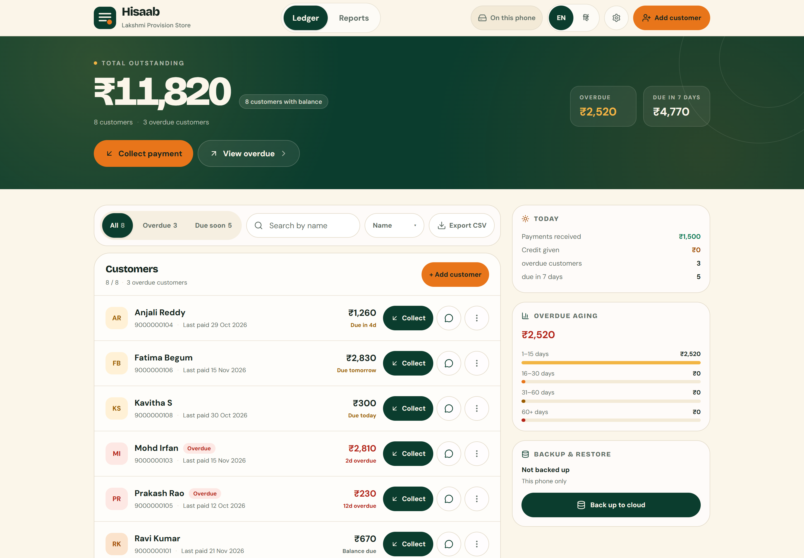

# Hisaab — Kirana Credit Ledger

A local-first kirana credit ledger with real overdue aging, quick payment collection, WhatsApp reminders, reports, and optional Supabase cloud backup.



## What is in this build

- **Local-first storage.** The ledger lives in IndexedDB, not the old 5 MB `localStorage` slot. Saving failures are reported instead of being swallowed.
- **Real overdue aging.** Payments are allocated to the oldest credits (FIFO), each credit gets a due date from the shop's credit period, and the Overdue tab only shows customers with money past due.
- **Safe imports.** A file is validated all-or-nothing, a local backup of the current ledger is saved first, and a preview is shown before anything is replaced.
- **Cloud backup.** Supabase email magic-link auth, row-level security, versioned snapshot save, merge on conflict, and server-side backups before imports.
- **Faster collections.** A quick “Receive payment” sheet from the header, ledger or customer page, with cash/UPI/other and an optional payment screenshot with OCR amount detection.
- **Reports.** This month's credit and collections, aging buckets, top balances, six-month trend, and cash vs UPI.
- **Bilingual UI.** English and हिंदी, with the credit period, reminder language and customer notes in settings.
- **New brand.** Deep green, saffron and cream; Bricolage Grotesque + DM Sans; 44 px touch targets; measured WCAG AA contrast; 375 px layout with no horizontal scroll.

## Run locally

```powershell
npm install
Copy-Item .env.example .env.local
# put VITE_SUPABASE_URL and VITE_SUPABASE_ANON_KEY in .env.local
npm run dev
```

The repo now installs with plain npm and commits `package-lock.json`. The old `bun.lock` was removed because bun is not installed here and the lock did not include the new Supabase dependencies.

Useful commands:

```powershell
npm test          # 24 ledger/import/aging tests
npm run lint      # tsc --noEmit
npm run build     # production build
```

The sample data is synthetic and its dates are generated relative to today, so the demo always has recent activity. The sample and default shop name is **Lakshmi Provision Store**.

## Supabase setup (one-time)

The app is safe to run without cloud; it asks whether to use the phone only or sign in.

1. Open the Supabase SQL editor and run [`supabase/migrations/0001_init.sql`](supabase/migrations/0001_init.sql). It creates `shops`, `ledger_snapshots`, `ledger_backups`, the new-user trigger, the versioned save function, RLS policies and grants. If the tables are missing, Settings shows a **Cloud setup required** card with **Copy setup SQL** and **Open Supabase SQL editor**; run it, then tap **Sync now** (the app retries shop creation automatically).
2. In **Authentication → URL Configuration**, set:
   - **Site URL**: `https://hisaab-indol.vercel.app`
   - **Redirect URLs**: `https://hisaab-indol.vercel.app` and `http://localhost:3000`
3. Email is the enabled auth provider in this project. A production shop should connect custom SMTP in Supabase so magic-link delivery is reliable.
4. Put the publishable key and project URL in `.env.local` and in Vercel's environment variables. This build accepts both names: `VITE_SUPABASE_URL` + `VITE_SUPABASE_ANON_KEY`, or `NEXT_PUBLIC_SUPABASE_URL` + `NEXT_PUBLIC_SUPABASE_PUBLISHABLE_KEY`. Never put a service-role key or database password in a `VITE_` or `NEXT_PUBLIC_` variable: both are published to the browser.

The publishable key is safe in the browser only because every table has RLS. If the SQL migration has not been run, signing in shows a clear cloud error; local mode keeps working.

## Data and privacy notes

- The phone's IndexedDB is the source of truth while offline. Cloud sync is a backup layer, not a requirement to record a payment.
- Receipt images are compressed and stored as data URLs inside the ledger snapshot. The app caps a single receipt at 2.5 MB and all receipts in an import at 8 MB. For a large shop, move receipts to Supabase Storage next.
- WhatsApp reminders are click-to-chat links opened by the shopkeeper. The app records that the reminder was opened; it cannot confirm delivery.
- Do not commit `.env.local`; it is ignored by `.gitignore`.

## Known limits

- Cloud sync is implemented but could not be exercised end-to-end until the SQL migration is run in the Supabase project.
- The live Vercel build is updated to commit `d039a40`, but it still says **“Cloud backup is not configured for this build”** until `VITE_SUPABASE_URL` and `VITE_SUPABASE_ANON_KEY` are added in Vercel and it is redeployed. The Supabase SQL migration is also still required.
- The main JS bundle is about 166 KB gzipped and the build warns about the 500 KB chunk. Splitting Supabase and the reports/settings views is the next performance step.
- Hindi mode still shows English month abbreviations in dates (`29 Oct 2026`); amounts use Indian grouping and ₹.
